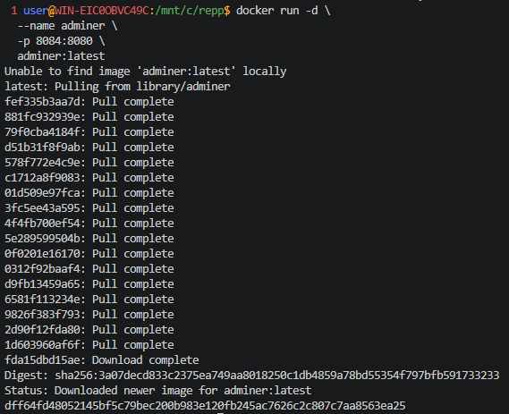
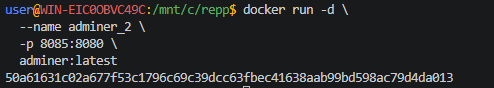
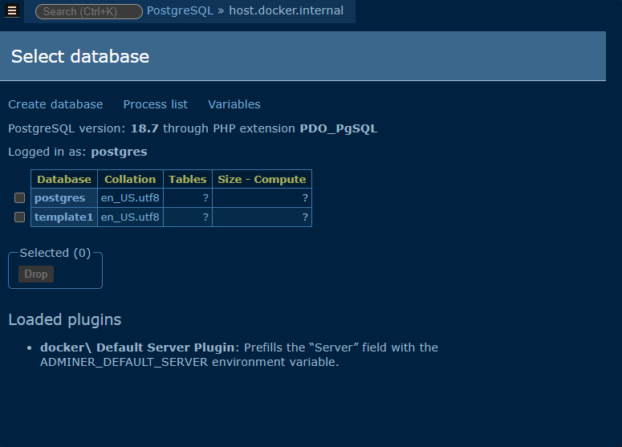

## Adminer (альтернатива phpMyAdmin)

Запуск Adminer для управления БД

> Никогда в разработке не используйте русские имена файлов и каталогов!

> Никогда в разработке не используйте пробелы и спец.символы в именах файлов и каталогов!

> Перед созданием проекта убедитесь, что порт 8084 не занят другим приложением!

> Создание проекта лучше начать с "чистого листа", предварительно остановив и удалив все другие контейнеры и образы!


Запустите **Adminer** в **Windows Powershell**
```shell
docker run -d `
  --name adminer `
  -p 8084:8080 `
  adminer:latest
```

Запустите **Adminer** в **Git-Bash/Linux/WSL 2.0/Mac**
```shell
docker run -d \
  --name adminer \
  -p 8084:8080 \
  adminer:latest
```
[Откройте: http://localhost:8084](http://localhost:8084)



При необходимости можно из этого же образа создать ещё один контейнер:
```shell
docker run -d \
  --name adminer_2 \
  -p 8085:8080 \
  adminer:latest
```
[Откройте: http://localhost:8085](http://localhost:8085)






> Без отдельно запущенного контейнера с БД PostgreSQL и связи с ним админ-панель работаеть не будет!

> Заполнять данные админ-панели не нужно!

Система:
- PostgreSQL
- сервер: host.docker.internal
- логин: postgres
- пароль: mysecretpassword