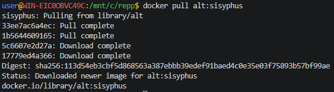
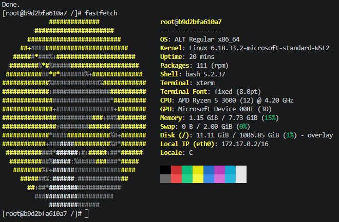

## Alt Linux в Docker

Выполните все этапы работы с проектом по примеру с [Nginx](/content/Docker/ImageLibrary/Nginx.md)

> Никогда в разработке не используйте русские имена файлов и каталогов!

> Никогда в разработке не используйте пробелы и спец.символы в именах файлов и каталогов!!

> Создание проекта лучше начать с "чистого листа", предварительно остановив и удалив все другие контейнеры и образы!

#### Использовать контейнер с Alt

##### Загрузить готовый образ Alt
```shell
docker pull alt:sisyphus
```



##### Запустить и использовать
```shell
docker run -ti --rm --name alt alt:sisyphus /bin/bash
```

#### Установить приложение Fastfetch в контейнере
```shell
apt-get update && apt-get install fastfetch
```

#### Запустить Fastfetch
```shell
fastfetch
```



##### Выйти из контейнера с Alt
```shell
exit
```

### Полезные ссылки

- [alt Docker Official Image](https://hub.docker.com/_/alt/)
- [Dockerfile](https://github.com/alt-cloud/docker-brew-alt/blob/p10/x86_64/Dockerfile)
- [Docker Alt Linux Image](https://github.com/sibsau/docker-alt/blob/master/README.md)