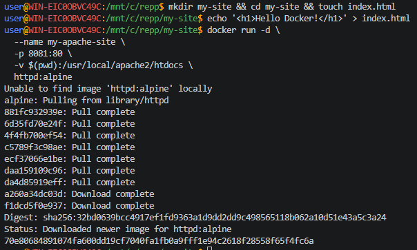
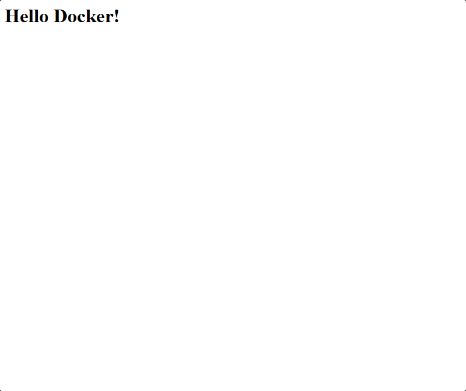

## Статический сайт на Apache

> Никогда в разработке не используйте русские имена файлов и каталогов!

> Никогда в разработке не используйте пробелы и спец.символы в именах файлов и каталогов!

> Создание проекта лучше начать с "чистого листа", предварительно остановив и удалив все другие контейнеры и образы!

### Apache со стандартной приветственной страницей контейнера

Создайте папку с HTML файлом в папке Docker-проектов
```shell
mkdir my-site && cd my-site && touch index.html
```

```shell
echo '<h1>Hello Docker!</h1>' > index.html
```

> Чтобы в веб-странице поддерживался русский язык, вставьте тэг `<meta charset="UTF-8">`

#### Запустите **Apache** с монтированием папки (для Windows)

Настройки Docker Desktop в Windows
- Откройте `Docker Desktop → Settings → Resources → File Sharing`;
- Убедитесь, что диск `C:\` есть в списке. Если нет – добавьте его;
- Перезапустить компьютер.

#### Запустите **Apache** с монтированием папки ()

> Перед созданием проекта убедитесь, что порт `8081` не занят другим приложением!

<u>Находясь в папке проекта</u> `my-site`, выполните загрузку образа, создание контейнера с сервером и его запуск:

для **Windows Powershell**
```shell
docker run -d `
  --name my-apache-site `
  -p 8081:80 `
  -v ${PWD}:/usr/local/apache2/htdocs `
  httpd:alpine
```

> Если эта команда в Powershell не работает, то удалите из кода апострофы `

для **Git-Bash/Linux/WSL 2.0/Mac**
```shell
docker run -d \
  --name my-apache-site \
  -p 8081:80 \
  -v $(pwd):/usr/local/apache2/htdocs \
  httpd:alpine
```



[Откройте: http://localhost:8081](http://localhost:8081)



Для изменения содержимого `index.html` выполните его редайтирование в **VS Code** из папки `my-site` на вашем компьютере (не внутри контейнера!)

Если по этому адресу будет откраться другая страница, то выполните `Ctrl+SHift+R` для VS Code и `Ctrl+R` в обычном браузере.