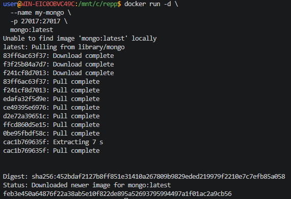
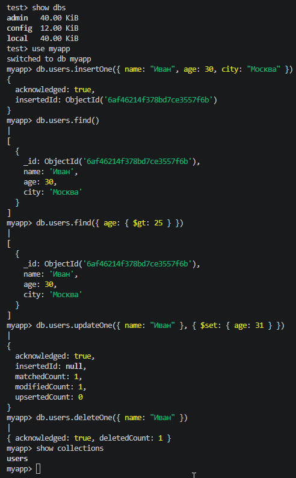

## MongoDB (NoSQL)

> Никогда в разработке не используйте русские имена файлов и каталогов!

> Никогда в разработке не используйте пробелы и спец.символы в именах файлов и каталогов!

> Создание проекта лучше начать с "чистого листа", предварительно остановив и удалив все другие контейнеры и образы!

1. Запуск **MongoDB**

в **Windows Powershell**
```shell
docker run -d `
  --name my-mongo `
  -p 27017:27017 `
  mongo:latest
```

> Если эта команда в Powershell не работает, то удалите из кода апострофы `

в **Git-Bash/Linux/WSL 2.0/Mac**
```shell
docker run -d \
  --name my-mongo \
  -p 27017:27017 \
  mongo:latest
```



2. Подключиться через shell
```shell
docker exec -it my-mongo mongosh
```

Повыполняйте какие-нибудь команды в этой БД для проверки и пришлите скрины

Посмотреть базы данных
```shell
show dbs
```
Создать/переключиться на базу
```shell
use myapp
```
Создать коллекцию и вставить документ
```shell
db.users.insertOne({ name: "Иван", age: 30, city: "Москва" })
```
Найти документы
```shell
db.users.find()
```
Найти с фильтром
```shell
db.users.find({ age: { $gt: 25 } })
```
Обновить документ
```shell
db.users.updateOne({ name: "Иван" }, { $set: { age: 31 } })
```
Удалить документ
```shell
db.users.deleteOne({ name: "Иван" })
```
Посмотреть коллекции
```shell
show collections
```


Выйти
```shell
exit
```