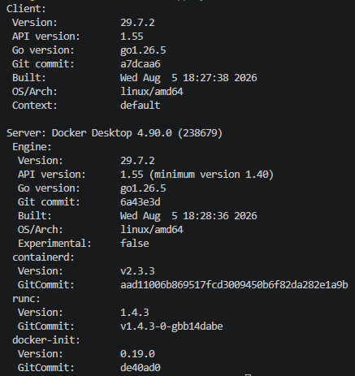
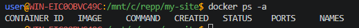
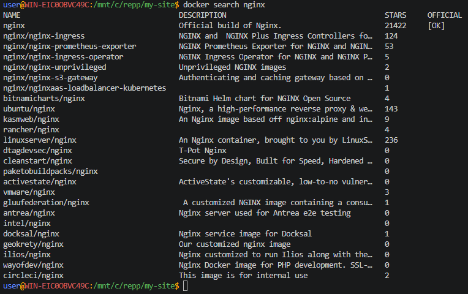
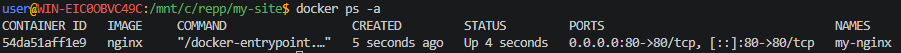
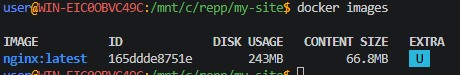
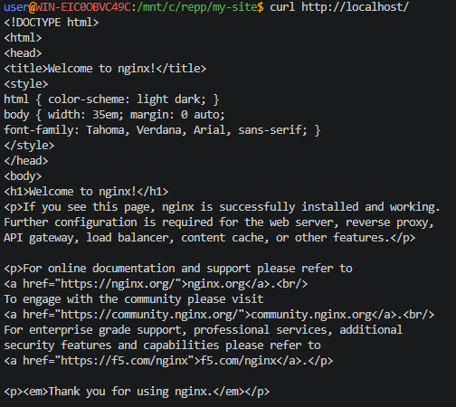
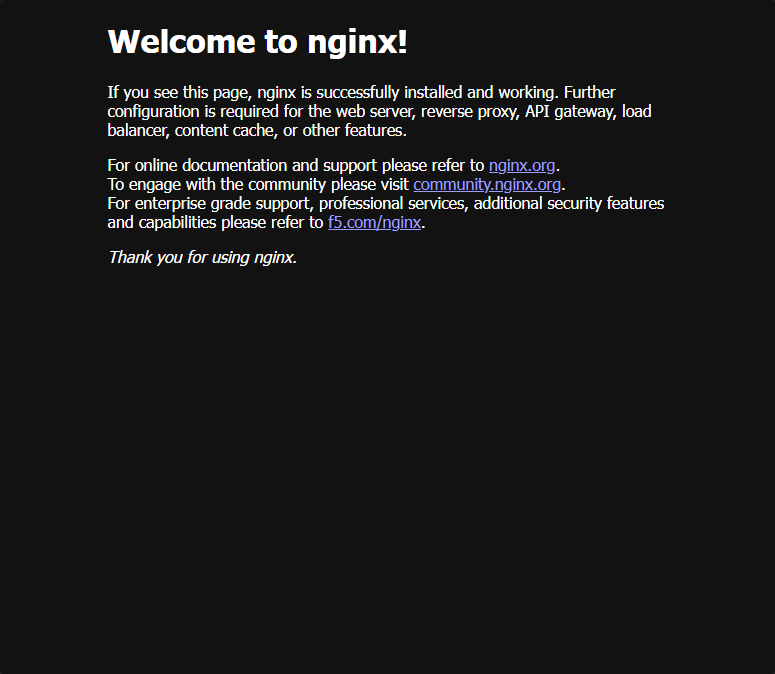

## Практическая работа на примере готового образа Nginx в Docker

> **Nginx** - это легкий и небольшой веб-сервер

> Никогда в разработке не используйте русские имена файлов и каталогов!

> Никогда в разработке не используйте пробелы и спец.символы в именах файлов и каталогов!

> Создание проекта лучше начать с "чистого листа", предварительно остановив и удалив все другие контейнеры и образы!

## Этапы

### 1. Проверить Docker

Получить версию установленного у вас Docker
```shell
docker version
```



> Готовые образы берутся из сторонних источников: **Docker Hub** или другие

[Ссылка на Docker Hub](https://hub.docker.com/)

### 2. Подготовка Docker (чтобы начать работать с "чистого листа")

1. Остановить все запущенные контейнеры
1. Удалить все остановленные контейнеры
1. Удалить все неиспользуемые образы

- Следует убедиться, нет ли у вас уже установленных и запущенных контейнеров:
```shell
docker ps -a
```
- Если есть, то лучше их остановить:
```shell
docker stop $(docker ps -q)
```
- Если остановленные контейнеры не нужно, то удалить их:
```shell
docker container prune
```
или
```shell
docker container prune $(docker ps -q)
```
- Ещё раз убедиться, что нет лишних контейнеров:
```shell
docker ps -a
```



- Опционально можно удалить ненужные образы. Показать текущие образы:
```shell
docker images
```
Удалить все ненужные образы
```shell
docker image prune -a
```
или
```shell
docker rmi $(docker images -q)
```

> Удалять нужно только учебные контейнеры и образы, т.к. есть риск потерять важные данные, которые могут содержаться в контейнерах!

### 3. Получение готового образа Nginx

1. Поиск и получение готового образа на Docker Hub
1. Создание и запуск контейнера из полученного образа
1. Проверка состояния приложения из Docker-контейнера
1. Управление контейнером

Найти нужный образ на **Docker Hub**
```shell
docker search nginx
```



Так же готовый образ можно искать в **Docker Desktop**

Получить, создать и запустить Nginx
```shell
docker run -d --name my-nginx -p 80:80 nginx
```

`docker run` объединяет команды `docker pull`, `docker create` и `docker start`

Если запуск контейнера не удался, то проверьте уже созданные контейнеры с таким именем у себя
```shell
docker ps -a
```



Показать загруженный на ваш компьютер образ
```shell
docker images
```



Показать работающий Nginx

Способ 1
```shell
curl http://localhost/
```



Способ 2 - [открыть http://localhost/ адрес в браузере](http://localhost/)



Опционально, если нужно только получить готовый образ, без создания и запуска контейнера, то
```shell
docker pull nginx
```

Получить информацию по загруженному образу:
```shell
docker inspect nginx
```

При необходимости остановить контейнер с таким именем:
```shell
docker stop my-nginx
```

Проверьте остановленное приложение в браузере по тому же адресу, обновив страницу по `Ctrl+R` или `F5`

Перезапустить контейнер по имени
```shell
docker restart my-nginx
```
Перезапустить контейнер по его **id**
```shell
docker restart id_контейнера
```
Перед удалением нужно остановить указанный контейнер
```shell
docker stop my-nginx
```

Опционально можно удалить выбранный контейнер по его имени
```shell
docker rm my-nginx
```

Если нужно создать ещё один контейнер из этого образа, то:
```shell
docker run -d --name nginx-my -p 81:80 nginx
```

> изменить имя и порт приложения!

[Открыть в браузере приложение из 2-го контейнера по адресу http://localhost:81/](http://localhost:81/)

И можно удалить ещё и образ загруженного ранее **Nginx**:

Получить id образа
```shell
docker images
```

Опционально можно удалить по `id` нужный образ
```shell
docker rmi id_образа
```

### 4. Проверить работу контейнера

Можно снова установить и запустить Nginx (если его удаляли ранее)
```shell
docker run -d --name my-nginx -p 80:80 nginx
```

Показать наличие загруженного файла образа
```shell
docker images
```

Показать только запущенные контейнеры
```shell
docker ps
```
или показать все контейнеры (в т.ч. остановленные)
```shell
docker ps -a
```

> Из одного образа можно получить несколько контейнеров!

### 5. Управление контейнером

#### Мониторинг контейнеров

Показать состояние всех контейнеров
```shell
docker ps -a
```

Показать подробности о контейнере
```shell
docker inspect my-nginx
```

Запустить мониторинг контейнеров
```shell
docker stats
```


> Выйти из мониторинга контейнеров можно по `Ctrl+C`

Получить лог контейнера
```shell
docker logs my-nginx
```

Показать логи в режиме ожидания
```shell
docker logs -f my-nginx
```
> Выйти из логов в режиме ожидания можно по `Ctrl+C`

#### Управление контейнером

Остановить контейнер
```shell
docker stop my-nginx
```

Снова запустить контейнер
```shell
docker start my-nginx
```

Перезапустить контейнер
```shell
docker restart my-nginx
```

Зайти в контейнер
```shell
docker exec -it my-nginx /bin/bash
```
или
```shell
docker exec -it my-nginx bash
```
или
```shell
docker exec -it my-nginx /bin/sh
```
или
```shell
docker exec -it my-nginx sh
```

внутри контейнера можно повыполнять некоторые команды Linux
Получить информацию об ОС контейнера
```shell
uname -a
```

Получить больше информации об ОС контейнера
```shell
cat /etc/os-release
```

Установить **Fastfetch**
```shell
apt update && apt install -y fastfetch
```
> apt update - обновит списки источников приложений, apt install - установит указанное приложение
Запустить **Fastfetch**
```shell
fastfetch
```

Можно установить ещё несколько приложений внутри Docker-контейнера:
```shell
apt update && apt install -y fastfetch htop inxi cmatrix hollywood caca-utils mc micro
```
> На все вопросы ответьте `1` и `Enter`

и позапускать их отдельно друг от друга:
```shell
htop
```

> Выйти из `htop` можно по **Q**

```shell
cmatrix
```

> Выйти из `cmatrix` можно по **Q**

```shell
hollywood
```

> Выйти из `hollywood` можно по `Ctrl-C`

Выйти из контейнера можно командой `exit`

Отредактировать текст страницы приветствия **Nginx** (Находится в разработке!)

Если вы случайно вышли из контейнера, то снова выполните вход:
```shell
docker exec -it my-nginx /bin/bash
```
Открыть файл `index.html` для редактирования содержимого
```shell
micro /usr/share/nginx/html/index.html
```
Файл index.html
```html
<!DOCTYPE html>
<html>
<head>
    <meta charset="UTF-8">
    <title>Приветственная страница index.html</title>
</head>
<body>
    <h1>Привет из контейнера index.html! 🐳</h1>
    <p>Здесь может быть любой русский текст.</p>
</body>
</html>
```
отредайтируйте и сохраните по `Ctrl+S` и выйти из режима редактирования по `Ctrl+Q`

[Проверить изменения на открытой странице >>](http://localhost/)

Выйти из контейнера:
```shell
exit
```

Остановить все запущенные контейнеры
```shell
docker stop $(docker ps -q)
```

Удалить все остановленные контейнеры
```shell
docker container prune $(docker ps -q)
```

Удалить все образы
```shell
docker rmi $(docker images -q)
```