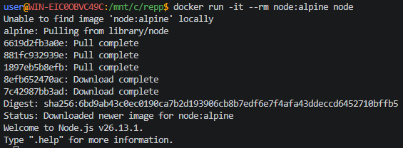
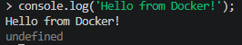
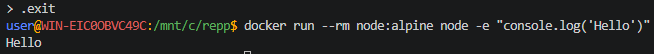

## Node.js для JavaScript

> Никогда в разработке не используйте русские имена файлов и каталогов!

> Никогда в разработке не используйте пробелы и спец.символы в именах файлов и каталогов!

> Создание проекта лучше начать с "чистого листа", предварительно остановив и удалив все другие контейнеры и образы!

Запустить **Node.js REPL**
```shell
docker run -it --rm node:alpine node
```



И запустить скрипт
```shell
console.log('Hello from Docker!');
```



Для выхода из консоли
```shell
.exit
```

или
```shell
docker run --rm node:alpine node -e "console.log('Hello')"
```

