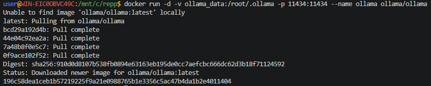
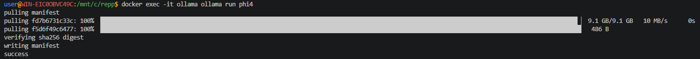
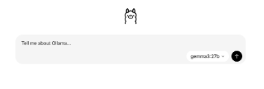

## Запуск Ollama в контейнере

### 1. Ollama+phi4

Получить ollama:
```shell
docker run -d -v ollama_data:/root/.ollama -p 11434:11434 --name ollama ollama/ollama
```



```shell
docker exec -it ollama ollama run phi4
```



выйти из командного режима нейросети:
```shell
/exit
```
и
```shell
/bye
```

---

### 2. Open WebUI и Ollama

```shell
docker run -d -p 3000:8081 -v ollama:/root/.ollama -v open-webui:/app/backend/data --name open-webui --restart always ghcr.io/open-webui/open-webui:ollama
```
[Открыть чат в браузере](http://localhost:3000)
или
[Открыть чат в браузере](http://0.0.0.0:3000)

или через другой порт:
```shell
docker run -d -p 8081:8080 \
  -v ollama:/root/.ollama \
  -v open-webui:/app/backend/data \
  --name open-webui \
  --restart always \
  ghcr.io/open-webui/open-webui:ollama
```
[Открыть чат в браузере](http://localhost:8081)



Загрузить модель, например `llama3.2:1b`
```shell
docker exec -it open-webui ollama pull llama3.2:1b
```
показать установленные модели:
```shell
docker exec -it open-webui ollama list
```

