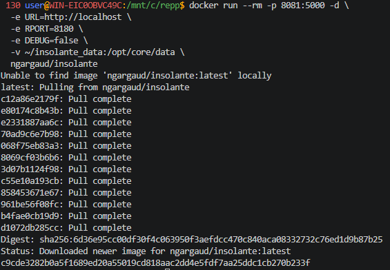
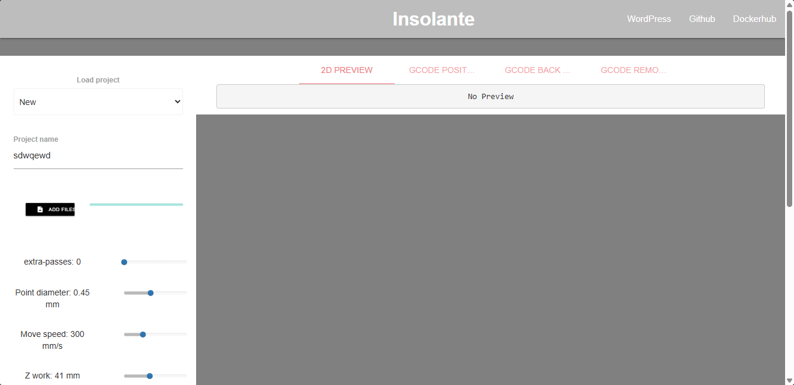

## Pcb2gcode web application wrapper

> Никогда в разработке не используйте русские имена файлов и каталогов!

> Никогда в разработке не используйте пробелы и спец.символы в именах файлов и каталогов!

> Создание проекта лучше начать с "чистого листа", предварительно остановив и удалив все другие контейнеры и образы!

Оболочка для веб-приложения **Pcb2gcode**. Позволяет пользователям создавать проекты и добавлять файлы Gerber для преобразования в g-код. Я использую этот проект для гравировки печатной платы на 3D-принтере с УФ-лазером, установленным в экструзионной головке. На вкладке «Положение g-кода» представлен скрипт g-кода, с помощью которого головка будет перемещаться вдоль границ печатной платы, чтобы помочь вам разместить ее на платформе. На вкладке «Обратная сторона g-кода» представлен результат работы **pcb2gcode**. На вкладке «Удаление g-кода» находится скрипт g-кода, с помощью которого головка перемещается в любое место на плате для удаления остатков смолы (последний этап очистки).

### Создаём папку для данных (если её нет)

#### Для Git-Bash/Linux/macOS:

```shell
mkdir -p ~/insolante_data
```

#### Для Windows (PowerShell):

Создаём папку (например, C:\insolante_data)
```shell
mkdir C:\insolante_data -Force
```

Загружаем образ, создаём и запускаем контейнер:

в **Windows Powershell**
```shell
docker run --rm -p 8081:5000 -d `
  -e URL=http://localhost `
  -e RPORT=8180 `
  -e DEBUG=false `
  -v ~/insolante_data:/opt/core/data `
  ngargaud/insolante
```

> Если эта команда в Powershell не работает, то удалите из кода апострофы `

в **Git-Bash/Linux/WSL 2.0/Mac**
```shell
docker run --rm -p 8081:5000 -d \
  -e URL=http://localhost \
  -e RPORT=8180 \
  -e DEBUG=false \
  -v ~/insolante_data:/opt/core/data \
  ngargaud/insolante
```





[Открыть проект в браузере http://localhost:8081](http://localhost:8081)

Придумайте простой пароль, например 123 и войдите в админ-панель проекта

[Docker-версия Pcb2gcode](https://hub.docker.com/r/ngargaud/insolante)