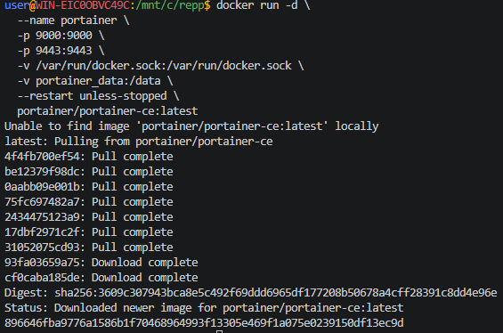
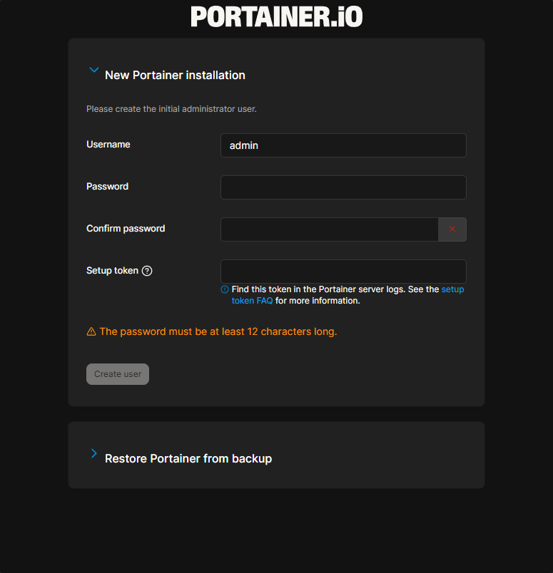

## Portainer

**Portainer** — это открытый инструмент с графическим интерфейсом, который упрощает управление контейнерной инфраструктурой (контейнерами, образами, сетями, томами) на базе Docker, Docker Swarm и Kubernetes.

> Никогда в разработке не используйте русские имена файлов и каталогов!

> Никогда в разработке не используйте пробелы и спец.символы в именах файлов и каталогов!

> Создание проекта лучше начать с "чистого листа", предварительно остановив и удалив все другие контейнеры и образы!

### Вариант с томами (с сохранением данных)

в **Windows Powershell**
```shell
docker run -d `
  --name portainer `
  -p 9000:9000 `
  -p 9443:9443 `
  -v /var/run/docker.sock:/var/run/docker.sock `
  -v portainer_data:/data `
  --restart unless-stopped `
  portainer/portainer-ce:latest
```

> Если эта команда в Powershell не работает, то удалите из кода апострофы `

в **Git-Bash/Linux/WSL 2.0/Mac**
```shell
docker run -d \
  --name portainer \
  -p 9000:9000 \
  -p 9443:9443 \
  -v /var/run/docker.sock:/var/run/docker.sock \
  -v portainer_data:/data \
  --restart unless-stopped \
  portainer/portainer-ce:latest
```



[Подключиться через браузер по http://localhost:9000/](http://localhost:9000/)



Создайте пароль администратора (минимум 8 символов) и войдите в админ-панель и в ней нажать кнопку **Home**, сделать скриншот.

Чтобы получить токен для создания пользвателя, смотрите лог этого контейнера

Получить лог:
```shell
docker logs portainer
```

Либо без токена

Windows:
```shell
docker run -d `
  --name portainer `
  -p 9000:9000 `
  -p 9443:9443 `
  -v /var/run/docker.sock:/var/run/docker.sock `
  -v portainer_data:/data `
  --restart unless-stopped `
  portainer/portainer-ce:latest `
  --no-setup-token
```
Linux:
```shell
docker run -d \
  --name portainer \
  -p 9000:9000 \
  -p 9443:9443 \
  -v /var/run/docker.sock:/var/run/docker.sock \
  -v portainer_data:/data \
  --restart unless-stopped \
  portainer/portainer-ce:latest \
  --no-setup-token
```

Если не появляется окно создания пароля, то выполните сл.действия:
- `docker run --rm -v portainer_data:/data portainer/helper-reset-password`
- Скопируйте логин и пароль после строки "Use the following password to login:"

Либо создать пароль сразу при создании и запуске контейнера (пока не сработало):

Windows
```shell
docker run -d `  --name portainer `  -p 9000:9000 `  -p 9443:9443 `  -v /var/run/docker.sock:/var/run/docker.sock `  -v portainer_data:/data `  --restart unless-stopped `  portainer/portainer-ce:latest `  --admin-password "&XF5871L[vjg2"
```
Linux
```shell
docker run -d \
  --name portainer \
  -p 9000:9000 \
  -p 9443:9443 \
  -v /var/run/docker.sock:/var/run/docker.sock \
  -v portainer_data:/data \
  --restart unless-stopped \
  portainer/portainer-ce:latest \
  --admin-password "&XF5871L[vjg2"
```

### Основные возможности

Dashboard (Главная панель):
- Обзор всех контейнеров, образов, сетей, томов
- Использование ресурсов (CPU, RAM, диски)
- Быстрый доступ к логам, консоли
    - Dashboard показывает:
        - Количество контейнеров (работающих/остановленных)
        - Использование CPU и памяти
        - Сетевой трафик
        - Активность дисков

Что можно делать с контейнерами:
* Создавать/удалять/останавливать/перезапускать
* Просматривать логи в реальном времени
* Открывать терминал внутри контейнера
* Копировать файлы в/из контейнера
* Просматривать статистику использования ресурсов
* Экспортировать/импортировать контейнеры

- Образы (Images):
    - Просмотр всех образов
    - Pull новых образов из Docker Hub
    - Удаление образов
    - Сборка образов из Dockerfile
- Сети (Networks):
    - Создание пользовательских сетей
    - Просмотр сетевой топологии
    - Подключение/отключение контейнеров к сетям
- Тома (Volumes):
    - Создание и удаление томов
    - Просмотр содержимого томов
    - Резервное копирование томов
- Стеки (Stacks):
    - Развёртывание Docker Compose файлов
    - Управление несколькими сервисами
    - Просмотр логов и статуса стека