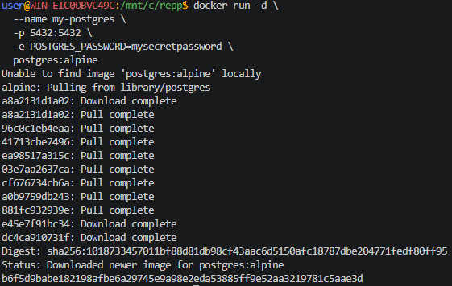
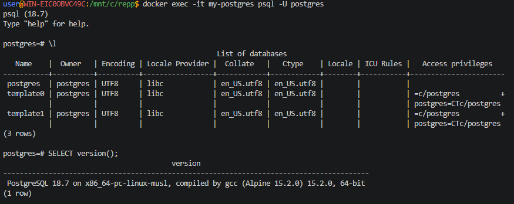

## PostgreSQL

> Никогда в разработке не используйте русские имена файлов и каталогов!

> Никогда в разработке не используйте пробелы и спец.символы в именах файлов и каталогов!

> Создание проекта лучше начать с "чистого листа", предварительно остановив и удалив все другие контейнеры и образы!

Запуск **PostgreSQL** с паролем

в **Windows Powershell**
```shell
docker run -d `
  --name my-postgres `
  -p 5432:5432 `
  -e POSTGRES_PASSWORD=mysecretpassword `
  postgres:alpine
```

> Если эта команда в Powershell не работает, то удалите из кода апострофы `

в **Git-Bash/Linux/WSL 2.0/Mac**
```shell
docker run -d \
  --name my-postgres \
  -p 5432:5432 \
  -e POSTGRES_PASSWORD=mysecretpassword \
  postgres:alpine
```



Подключиться через `psql`
```shell
docker exec -it my-postgres psql -U postgres
```

- Выполнить несколько демонстрационных команд, например:

Получить список баз данных:
```sql
\l
```
Получить версию:
```sql
SELECT version();
```



выйти из БД
```sql
exit
```