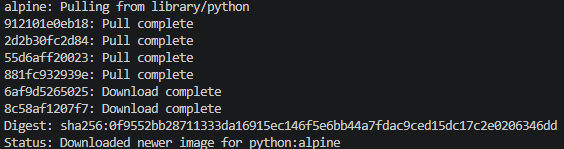

## Python для запуска скриптов

> Никогда в разработке не используйте русские имена файлов и каталогов!

> Никогда в разработке не используйте пробелы и спец.символы в именах файлов и каталогов!

> Создание проекта лучше начать с "чистого листа", предварительно остановив и удалив все другие контейнеры и образы!

1. Создайте **Python** скрипт

в **Git-bash**
```shell
echo "print('Hello from Python in Docker')" > script.py
```
или в **PowerShell**
```shell
echo "print('Hello from Python in Docker')" | Set-Content -Path script.py -Encoding utf8
```

2. Запустите скрипт в контейнере с **Python**

в **Git-Bash**
```shell
docker run --rm -v "$(pwd)":/app python:alpine python /app/script.py
```



- [Script](/Docker/Python/script.py)

или в **PowerShell**
```shell
docker run --rm -v ${pwd}:/app python:alpine python /app/script.py
```
3. Интерактивный **Python** (опционально)
```shell
docker run -it --rm python:alpine python
```