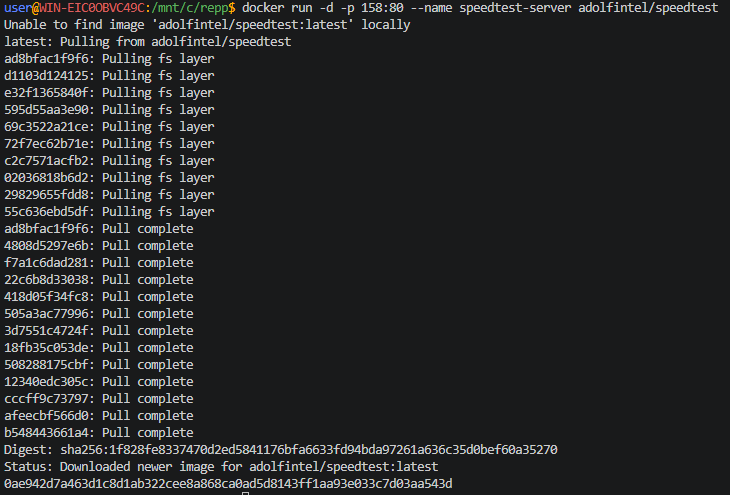
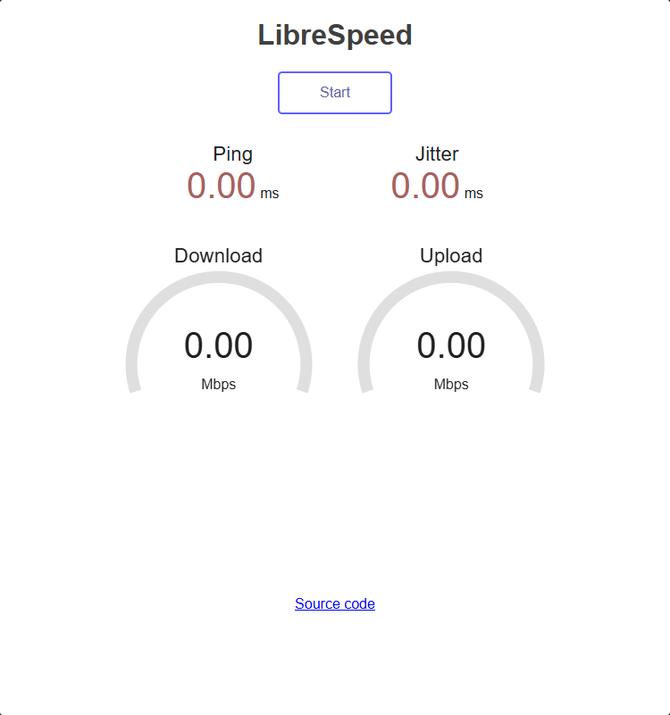

## Тест скорости интернета (в РФ может не работать из-за блокировок РКН!)

> Никогда в разработке не используйте русские имена файлов и каталогов!

> Никогда в разработке не используйте пробелы и спец.символы в именах файлов и каталогов!

> Создание проекта лучше начать с "чистого листа", предварительно остановив и удалив все другие контейнеры и образы!

1. **Speedtest** в **Docker**
```shell
docker run -d -p 158:80 --name speedtest-server adolfintel/speedtest
```



[Открыть в браузере http://localhost:158/](http://localhost:158/)

