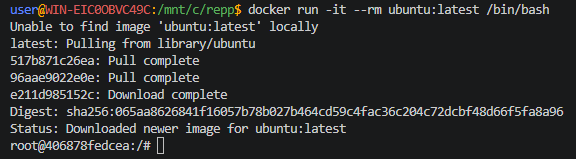

## Ubuntu для тестирования команд

> Никогда в разработке не используйте русские имена файлов и каталогов!

> Никогда в разработке не используйте пробелы и спец.символы в именах файлов и каталогов!

> Создание проекта лучше начать с "чистого листа", предварительно остановив и удалив все другие контейнеры и образы!

**Ubuntu** - популярный Linux-дистрибутив.

Загрузка, запуск и вход во временный **Ubuntu** контейнер:
```shell
docker run -it --rm ubuntu:latest /bin/bash
```
> Контейнер удалится автоматически (`--rm`)



> Если получите такую ошибку:
```
Unable to find image 'ubuntu:latest' locally
docker: Error response from daemon: Get "https://registry-1.docker.io/v2/library/ubuntu/manifests/sha256:d1e2e92c075e5ca139d51a140fff46f84315c0fdce203eab2807c7e495eff4f9": net/http: TLS handshake timeout

Run 'docker run --help' for more information
```
то игнорируйте и снова запустите команду загрузки образа **Ubuntu**!

Установите что-нибудь внутри, например:
```shell
apt update && apt install neofetch
```
```shell
curl --version
```

Выйти из контейнера можно по команде `exit`

> Внимание: этот контейнер удаляется автоматически после выхода из него!